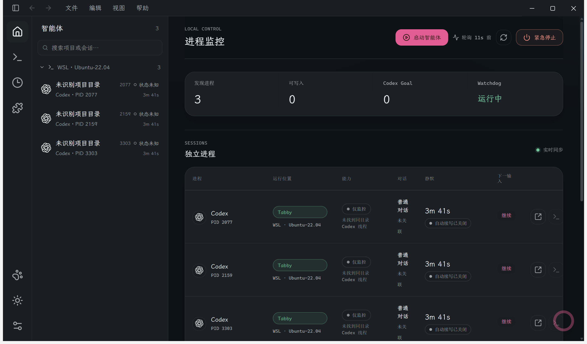
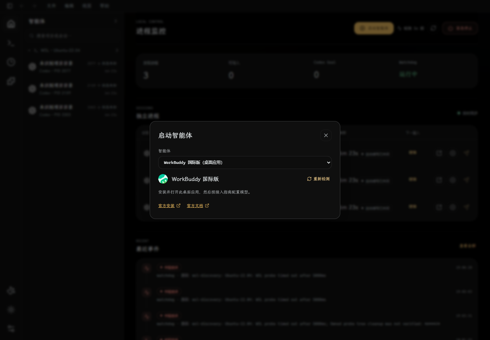
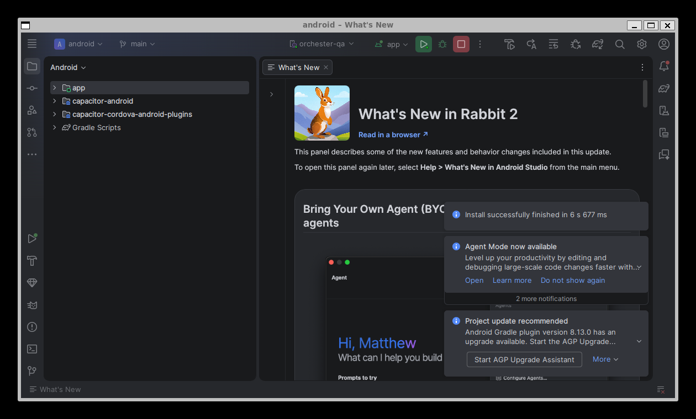
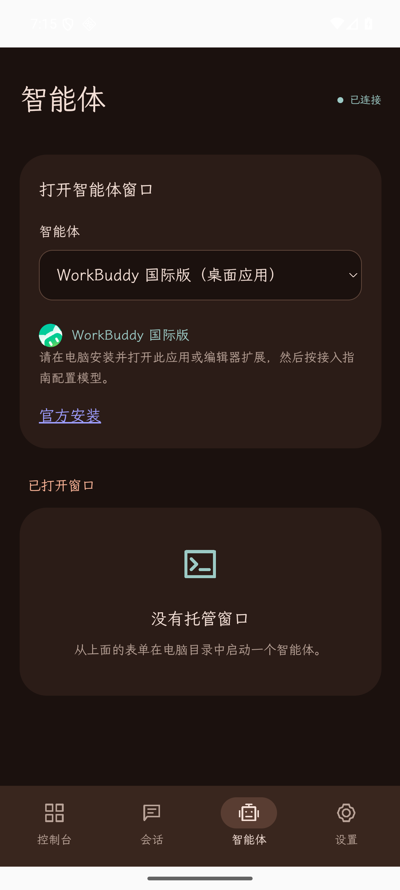

# AgentRouter 集成与本机实测（2026-11-11）

产品代码为 [`f85ce74`](https://github.com/dieWehmut/Selbstlauf/commit/f85ce747ac68c960c2fdbe9e5e7f2b7e9ab00057)。本机 Windows Selbstlauf 已安装此代码的 x64 包，Android Studio 已打开工程并通过 IDE Run 安装、启动最新 APK；两端实际目录、官方图标和原生交互验证通过。

## 覆盖与行为

- 覆盖 [AgentRouter 文档](https://agentrouter.org/docs/) 的 17 篇指南、16 个产品，以及首页的 Gemini CLI；完整产品与发布方链接见[实施记录](../implementation/agentrouter-agents.md)。
- 启动目录有 **24 项**，含 WorkBuddy [国内版](https://www.workbuddy.cn/)与[国际版](https://www.workbuddy.ai/)两个独立安装入口。国内版保留 `workbuddy` ID，国际版为 `workbuddy-intl`。它们分别使用自己的官网和帮助地址；当前 AgentRouter 国内版指南没有冒挂到国际版。
- 环境目录有 **13 个 CLI**，12 个支持应用内 npm 安装/升级，Hermes 提供官方 Python 手动流程。缺失 CLI 可打开实际安装面板；桌面应用及扩展打开对应官方指南，PTY API 拒绝将它们作为 CLI 启动。
- **22 个具品牌的目录项**共用 21 个发布方图像文件、20 种产品图形。Claude Code/App 共用 Claude 标识，Codex 有官方明暗两份，WorkBuddy 两地区官网的 SVG 完全相同。全部来源和 SHA-256 见[来源清单](../../apps/web/public/tool-icons/sources.json)。WebUI、桌面和 Android 共用文件映射。
- 进程识别读取真实可执行文件与实际解释器入口。提示词、eval/preload、改名的进程标题和运行时选项值不再冒充 agent；工作目录只读取入口后的 agent 参数。WorkBuddy 进程没有地区证据时显示通用产品名。

新增工具提供进程监控；对话、活动或输入适配不可确认时保留未知并显示能力限制。受管 CLI 窗口提供真实 PTY 输入输出。本次没有安装缺失的全局 agent 或更改模型/鉴权配置，也没有发送模型请求。

## 测试与 CI

| 检查 | 结果 | 本机持久证据 |
| --- | --- | --- |
| 最终 CLI 全套 | 467 项：453 通过、14 平台跳过、0 失败；原始进程 exit 0 | `tmp/agentrouter-final-20261111/qa/cli-full.log`、`cli-result.json` |
| Desktop / mobile 单元测试 | 171 / 31 全通过，原始进程 exit 0 | 同目录 `desktop-result.json`、`mobile-result.json` |
| 进程身份回归 | 9 项全部通过；覆盖提示词、raw argv、运行时值、真实入口、near miss、工作目录 | `apps/cli/test/process-identity.test.ts` |
| 浏览器与 Pages CI | 106 / 4 全通过，browser/build/deploy 全 success | 同目录 `ci/run-42997956985.log` |
| Windows 原生安装版 | 实际 API 24/13、22 品牌图标逐项解码及 SHA 验证、两版 WorkBuddy 交互、真实 ConPTY | `tmp/agentrouter-final-20261111/windows/` |
| Android 原生安装版 | 4 项仪器测试通过，26.755 秒；实际 WebView 24/13/22、22 图标解码、两版 WorkBuddy、旋转恢复 | `tmp/agentrouter-final-20261111/android/` |

[CI 42997956985](https://github.com/dieWehmut/Selbstlauf/actions/runs/42997956985) 的实际 HEAD 是 `8e65d4f`。Git 对象证明最终 `f85ce74` 的 Web/mobile、共享 registry/environment、依赖和 Pages workflow 与该 CI 完全相同；后续变化仅为 CLI 进程识别及相关回归和实施说明。此处不将它表述为在 `f85ce74` 新运行的 CI。完整命令、源/编译输出逐字节对照及证据校验见本机 `qa/final-evidence-report.json` 和 `qa/README.md`。

关键命令为 `node --test --test-concurrency=1 apps/cli/dist/test/*.test.js`、Desktop 编译测试、mobile Vitest 单 worker，以及 Android Studio 的 Shift-F10 Run 和带独立网关参数的 `am instrument`。网页验证使用常规 Playwright；Browser 插件未提供。Windows 浏览器为 Edge 157.0.4341.42、1440×1000；原生窗口以 2584×1516 物理像素捕获。

## Windows 安装

安装位置为 `C:\Users\han\AppData\Local\Programs\Selbstlauf`，应用版本仍为 0.9.5，代码为 `f85ce74`。打包使用锁定 Windows 依赖和发布方校验的 Electron 44.4.1 缓存，`npmRebuild=false`、`publish=never`。没有以旧阶段包代替最终包。

| 对象 | SHA-256 / 核验 |
| --- | --- |
| 最终输入 manifest，38,442 字节 | `f7ea0216a158b7ae946fda0a3e9041031adc653247169fda7cd4fcd2a14f0e01` |
| `Selbstlauf-Setup-0.9.5-x64.exe`，172,573,168 字节 | `ab019be56b15e7b42d1b93a898fccb436a745112505a8b8614419bd6cc3cd022` |
| `app.asar`，541,508 字节 | `7e146479cc2bbe492f85e34a52567ebc5238898dc30f19e4695eb36c8cda3dd2` |
| 最终冻结输入 | 218 项，阶段文件及源构建输出全部匹配 |
| 安装文件 | **430 个文件全部与包匹配**，含 359 个资源树文件；仅 NSIS 卸载器为允许的额外文件 |
| 桌面 ASAR | 16 个冻结输入与 7 项元信息验证通过 |
| 安装前后用户配置 | 均为 `b9423f6297145f859cba41845d80ae20d25208524b286f378a358082af46229c` |

最终进程 PID 22996、HWND 1050392，11:00:26 UTC 从安装目录正常启动，11:11:21 UTC 仍运行。原生完成轮询从 `1794395220787` 推进到 `1794395223665`，11:11 复核为 `1794395478870`；提交前 12:21 UTC 再次确认同一 PID/starttime 与配置，完成轮询已推进到 `1794399660406`。浏览器页面、控制台、资源错误均为 0，目录/图标检查不发送 mutation 请求。

另外通过实际安装版 API 创建一个独立 Shell 会话，ConPTY 运行 `cmd.exe /d /c echo ...`，真实回显且 exit 0；仅删除该测试会话后确认列表、输出端点及 PID 均消失。安装前后的三个 WSL Codex 与一个原生 Node 用户进程保持原 PID/starttime；未启动替代用户 agent。

完整备份、包及原生证据保存在 `C:\Users\han\AppData\Local\Temp\selbstlauf-agentrouter-final-package-20261111-100433-2e562b1c\`。本机可直接读取 `windows/windows-final-verification-summary.json`、`file-verification-summary.json`、`installed-api-browser-verification.json`、原生窗口及 PTY/连续运行记录。

## Android Studio 实测

当前 Android 底座为 **Vue 3 + Capacitor 8.6.0**，与实际 Orchester 手机工程一致。此次没有迁移 Tauri。

Android Studio Rabbit 2 / 2026.2.2 Patch 1，PID 7829，正确工程 `apps/mobile/android` 为 READY；从 IDE 执行 Shift-F10 Run，IDE 日志明确记录部署 `de.diewehmut.selbstlauf` 和启动 `MainActivity`。设备为本机 `orchester-qa`、`emulator-5554`，**Android 16 / API 36 / x86_64**。APK 和实际安装的 `base.apk` SHA-256 都为 `cf7b8ff92d5ad8980a7beed8d4c953e05743f1d7d2185afe4b2e8341bc0967ed`。

四项原生测试验证 Keystore 密文/重建、原生 HTTP、主题重建、配对重连、会话操作与真实主机 Shell PTY。会话控制使用一次性 fixture，Shell 是真实进程；链路为 `adb reverse`，没有以模拟器结果声称物理手机 Wi-Fi 验收。

实际 WebView 原生 HTTP 目录包含 24 项、13 个 CLI、22 个品牌；逐项选择并执行 `img.decode()`，22 组均成功，读取字节均匹配 APK。主来源的 21 个图像全部进入 APK（13 个文件、3 个 base64、5 个 Vite SVG 编码）；WorkBuddy 两版与主原始 SVG SHA 均为 `10ccbc099e7bc3d5ff12c315c4edd7b21386aa7166c1ec19997b3d55010d5c7d`。

测试网关、fixtures、两个 QA 配对记录/Keystore 令牌、反向映射及 CDP 转发已清理；旋转设置恢复。KVM 临时用户 ACL 已移除，后续独立复核也清除了无额外授权的冗余 mask，精确恢复 `root:kvm 0660` 且 ACL xattr 不存在，证据为 `android/kvm-exact-restoration.json` 与 `final-result-after-cleanup.json`。为本机模拟器补齐的 `libpulse0` 等标准运行库保留。Studio、模拟器及无配对控制台保持打开。提交前复核 Studio 仍 READY、应用仍为 PID 5307、本轮 `tcp:9224` 转发已移除；后来出现的其它应用 `tcp:19327` 映射予以保留。

## 分步提交与复核

实现与修复分别提交并推送 `main`：`6e1e410`（目录/安装）、`8891b8e`（监控）、`6a87d57`（WSL 探测）、`426944e`（官方图标/界面）、`d661969`（安装入口一致性）、`8e65d4f`（WorkBuddy 双地区）、`f85ce74`（真实进程参数）。本记录单独提交，不改变已封包产品代码。

可审阅的精简机器记录见 [evidence.json](2026-11-11-agentrouter-evidence.json)。全部原始本机证据位于 `tmp/agentrouter-final-20261111/`，包含 QA 结果/校验、Windows 打包与安装、Android Studio 日志、原生测试与截图。

## 截图

