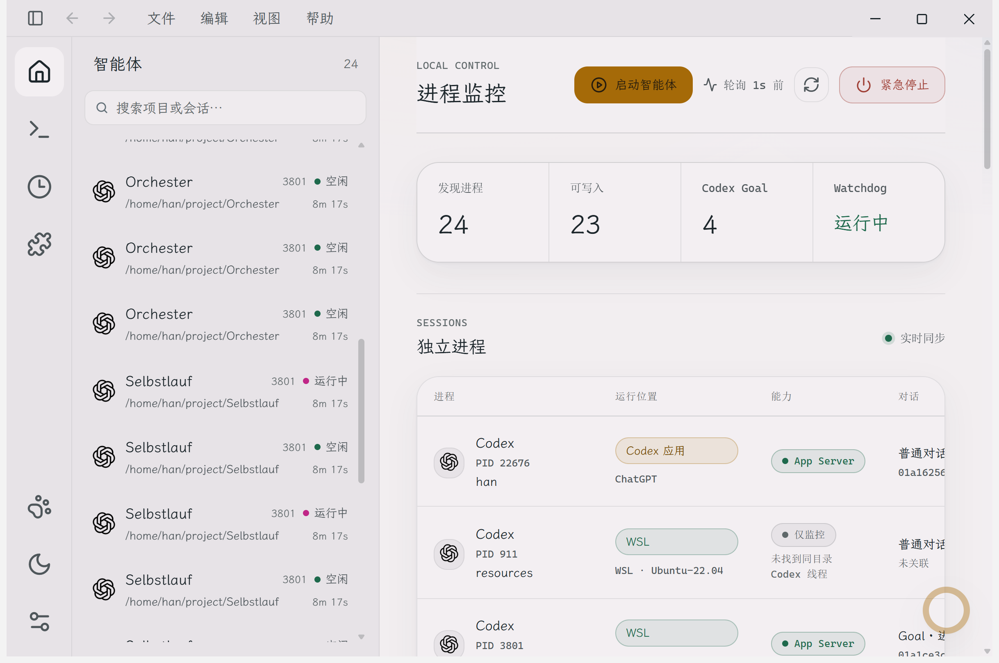
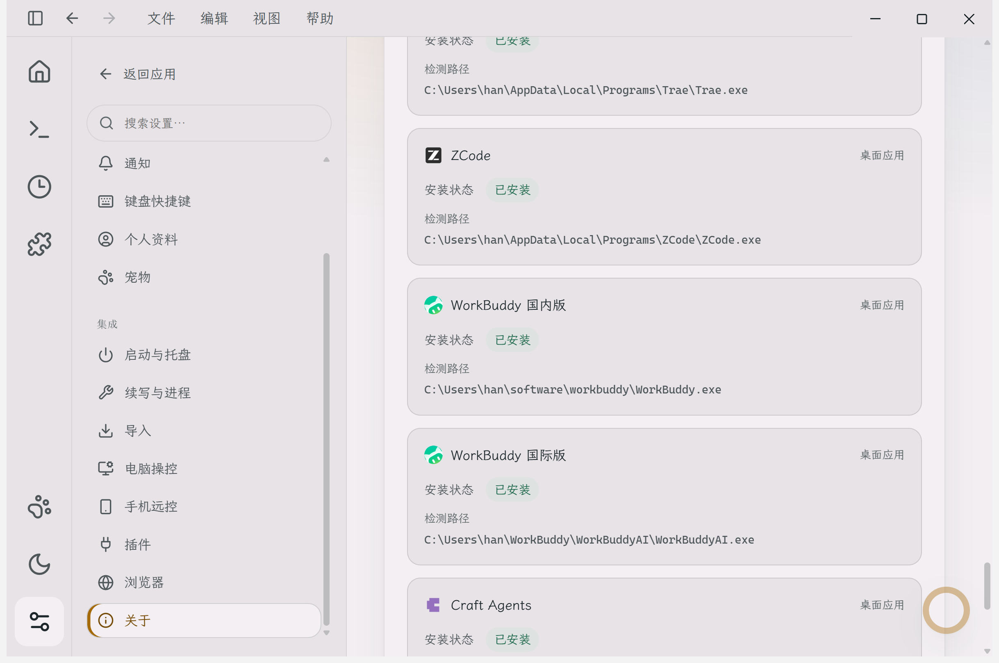
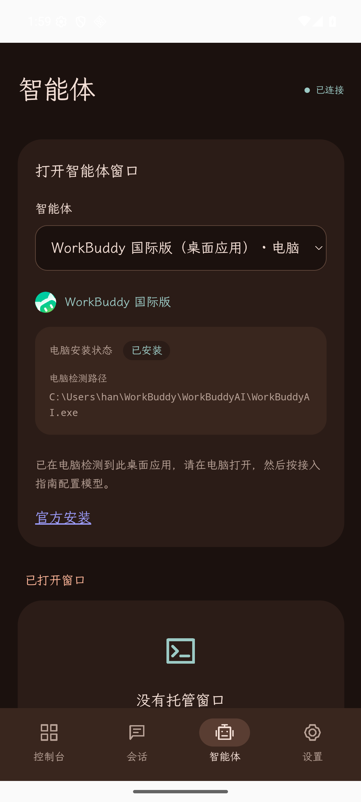
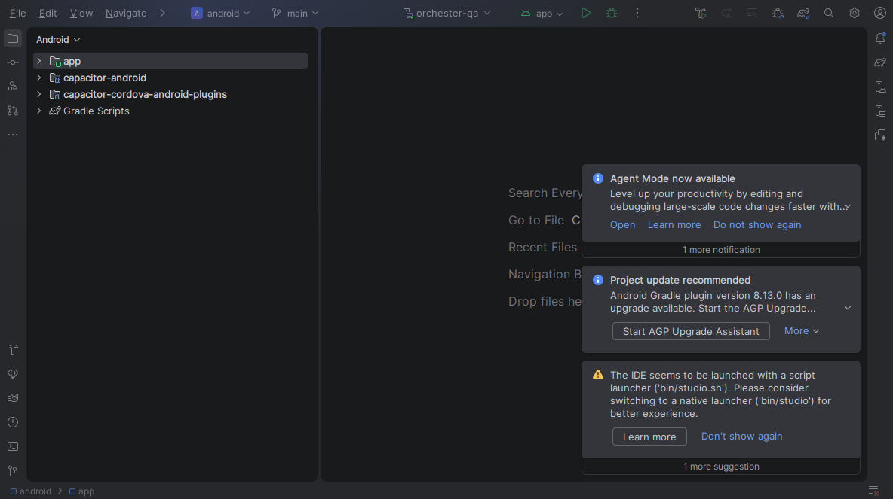

# 本机项目目录与 agent 应用检测验收

最终产品代码为 [`ca06072`](https://github.com/dieWehmut/Selbstlauf/commit/ca06072efd69cd6787f4b77675fc9ee05f8ca426)。本次继续处理安装版桌面应用不能识别真实项目目录、各 agent 应用检测不可见的反馈，并补齐手机显示和原生验证。

## 修复后的行为

- Codex 共享 App Server 中的每个活跃线程按内核 writer lock、进程启动身份、文件描述符及文件身份分别关联，显示真实项目目录。历史线程、仅存在的锁文件和 PID 维护循环不能建立活跃项目关联。
- WSL 状态库更新时刷新只读副本并保留输入连接。线程读取失败、整轮或部分进程采集失败时，保留上次确认的活跃项目并暂停输入和自动继续；完整恢复后重新关联，完整采集确认该进程或线程已消失后才标记退出。失败不复活已退休会话，当前用户过滤和所选分发仍生效。
- 本轮补齐局部 writer 元信息读取失败：有效锁文件、已知 owner 的 `stat`、描述符目录和 `fdinfo` 出错不会冒充成功空结果；残缺 `stat` 同样失败。正常退出竞争和已解析的消亡状态仍可确认失效，无关描述符故障不影响已独立验证的 owner。Native reader 和 WSL Python probe 使用相同规则。
- 22 个具品牌的应用、CLI 和扩展提供独立安装检测。启动面板与环境页显示已安装、未找到或未知，以及检测路径和扩展信息；命令是否可启动仍单独检查。WorkBuddy 国内版与国际版分别识别实际程序路径，发行商独立的 `WorkBuddyAI.exe` 可识别国际版进程。
- Android 现在显示电脑的安装状态、路径和全部已检测扩展。已安装的桌面应用提示在电脑打开；扩展已安装但 CLI 命令缺失时说明启动命令问题。手机不将电脑的安装状态描述为 Android 本机安装。
- 桌面列表中的普通 UUID 保持单行省略，完整 ID 可在提示和详情查看。真实 UUID 的浏览器复现行高从 213px 降到 85.5px；窄屏仍使用会话卡片。

[AgentRouter 覆盖与官方来源](../implementation/agentrouter-agents.md)继续包含全部 17 篇工具指南、24 个目录项、13 个 CLI 和 22 个品牌项。21 个发布方图像文件的 SHA 与[来源清单](../../apps/web/public/tool-icons/sources.json)一致；WorkBuddy 双版共用两地区官网相同的官方 SVG。先前完整目录、安装入口、真实 Shell PTY 和原生基础功能验证见[2026-11-11 记录](2026-11-11-agentrouter-agents.md)。

## 最终代码验证

| 检查 | 结果与范围 |
| --- | --- |
| Workspace 构建 | `npm run build`，exit 0 |
| CLI 全套 | 540 项：525 通过、15 平台跳过、0 失败，exit 0 |
| Web 全套单元测试 | 385 通过，exit 0 |
| Mobile 全套 / 类型检查 | 35 通过，含 4 项安装详情组件回归；类型检查 exit 0 |
| Desktop 既有全套 | 171 通过；当前 Desktop 源码与此已核验阶段相同，独立重新编译输出一致 |
| 最终 HEAD 远程 CI | 107 项浏览器、4 项 Pages；browser、build、deploy 全部 success |
| Writer 故障回归 | 两 reader 的必要读取故障、真实 EACCES、残缺元信息、退出竞争、无关 FD；controller 保留项目并拒绝输入、完整恢复及过滤切换 |
| 表格浏览器回归 | 同 daemon 的 8 个跨项目真实 UUID、详情完整 ID、长内容、40 会话、内部滚动、390px 卡片；页面溢出与 pageerror 均为 0 |

[CI 43164906791](https://github.com/dieWehmut/Selbstlauf/actions/runs/43164906791)实际 HEAD 为 `ca06072`，不是借用旧版本的 CI。日志和真实命令退出码位于 `tmp/project-discovery-fix-20261111/final-qa-20261112/`。第一次浏览器复现明确失败后再验证修复，不将 HTTP fixture 表述为原生应用验收。

## Windows 最终安装与实际窗口

已重新打包并安装 `ca06072` 的 Windows x64 0.9.5 应用，目录为 `C:\Users\han\AppData\Local\Programs\Selbstlauf`。使用锁定依赖及已校验 Electron 44.4.1，关闭发布；本轮没有覆盖先前失败安装证据。

| 对象 | 实际核验 |
| --- | --- |
| 冻结输入 | 211 项，全部与最终源码构建输出匹配 |
| 输入 manifest SHA-256 | `13b09447e203af9da310cea8a4fd15c900d40c9a0f0d22fd42bc8ddd540ea546` |
| 安装包 | 172,613,587 字节；SHA-256 `4cb371e6da4cf8c29c95da489b627a601cc7d8c292a2c68ffedaddc2109137b0` |
| 包资源 / Desktop ASAR | 187 / 16 项匹配 |
| 安装文件 | 439 项全部与包一致，含 368 个资源树文件 |
| 用户配置 | 安装和验收前后均为 `b9423f6297145f859cba41845d80ae20d25208524b286f378a358082af46229c` |
| 验收捕获窗口 | 新安装测试进程 PID 27100、HWND 1770990，真实 Electron renderer 与独立原生截图均核验归属 |

实际安装版完成轮询严格递增：`1794464253949 → 1794464257257 → 1794464260585`，同一活跃线程持续显示 `/home/han/project/Selbstlauf`；Orchester 和 miceye 同时存在。随后独立核对 21 个共享 daemon 线程，其内核 owner 和当前 rollout 元信息目录全部匹配，覆盖 Selbstlauf、Orchester、Entwurf、miceye 四个项目；PID 维护循环没有被当成会话。会话数量会随真实任务变化，核验不依赖固定数量。

真实 Electron 窗口中的 22 个唯一安装条目、所有路径和扩展与 API 一致；19 已安装、3 未找到。22 组官方图标（Codex 明暗共 23 张）均解码成功，HTTP 字节与冻结官方来源一致。实际窗口的会话行最大 90 CSS px，ID 不换行，完整值保留在提示；无目录匹配的 PID 911 显示中文只监控原因，输入按钮禁用。页面、资源与请求错误均为 0。

通过新进程所属 HWND 的 `PrintWindow PW_RENDERFULLCONTENT` 捕获三个不同的新帧，原生截图实际可见 Selbstlauf、Orchester 目录和两版 WorkBuddy 的不同安装路径。为当前非交互桌面验收临时使用仅绑定 loopback 的 Electron 调试端口及渲染参数，没有写入产品包或用户配置，也没有发送模型请求。用户 agent 的 PID 与启动身份保留。

验收后关闭测试实例，使用普通命令行重新打开同一安装版，最终保留 PID 4936、HWND 1967600，命令行仅含 `Selbstlauf.exe`，调试端口 60311 已关闭。正常启动后的完成轮询从 `1794465688527` 推进到 `1794465691924`，当前 Selbstlauf 线程仍活跃并关联正确目录。配置和原有四个 WSL、两个 Windows Node 用户进程身份再次核验不变。清理时 `taskkill` 对 WSL 探测子进程报告不支持，但测试主进程与调试监听已确认消失，没有重复终止操作。

完整本机阶段为 `C:\Users\han\AppData\Local\Temp\selbstlauf-final-discovery-20261112-055506-a1d51068\`，包含冻结清单、安装文件逐项对比、原生窗口归属、三轮 API 和独立内核 owner 证据。精简记录及截图校验见 [evidence.json](2026-11-12-project-and-application-evidence.json)。

## Android Studio 原生验证

手机底座继续使用 Vue 3 + Capacitor 8.6.0，与当前 Orchester 手机工程一致。用户关于 Tauri 的提问已按实际工程解释，本次没有迁移底座。

机器重启后重新打开正确的 `apps/mobile/android` 工程并等待 READY，从 Android Studio 执行 Run，安装和启动 `de.diewehmut.selbstlauf`。新 APK 为 18,838,724 字节，SHA-256 为 `19c6135b73b7a151f393fea1d9e726aae2ba30a3f5b8435137d1f97865b4bc16`，实际安装的 `base.apk` 与其一致。设备为本机 `orchester-qa` 模拟器、API 36。

真实安装的 WebView 通过 Capacitor 原生 HTTP 读取独立网关提供的实际 Windows 安装版只读快照，逐项核对 22 个唯一品牌的安装状态、路径、扩展与发布方链接；19 已安装、3 未找到。22 个图标全部解码成功，APK 中全部 21 个官方图像与来源清单及 Vite 编码对应。双版 WorkBuddy、Roo 扩展、未找到及未知状态分别验证。

这证明当前 APK 的原生 HTTP 与安装信息展示，范围是本机模拟器和独立网关快照；不将它表述为手机直连 Windows 远程网关或物理手机 Wi-Fi 验收。原生截图和逐项机器证据在 `tmp/project-discovery-fix-20261111/android-final-20261112/`。

两个测试网关、QA 配对记录和 Keystore token、全部本轮 ADB 映射已清理，旋转恢复，KVM 精确恢复 `root:kvm 0660` 且无 ACL xattr。Studio、模拟器及未配对应用保留打开；最终 Studio CLI 发现元数据丢失，但原进程、X11 窗口、监听端口及 IDE 部署日志仍证实同一实例运行。本轮没有重跑历史四项 instrumentation，新增验证是当前 APK 的实际 UI 和原生 HTTP。

## 适用范围

安装检测与活跃进程检测独立。本机有 3 项未找到：Grok Build、DeepSeek Harness、Claude App；本次安装的是 Selbstlauf 更新包，没有将它们冒称已安装。缺失工具保留各自发布方安装入口。

当前默认外部进程 provider 实现 Windows，并支持选定 WSL 分发；原生 Linux/macOS 实时进程 provider 尚未实现。共享 VS Code extensionHost 没有逐扩展的可信活跃身份时，只声明扩展安装可检测。新增工具多数提供进程监控，未具备对话或输入适配时保留未知及能力说明；受管 CLI 窗口的真实 PTY 能力不变。

## 分步提交

此前 ownership、状态刷新、实际进程入口、应用安装检测、共享 daemon 项目、线程读取和整轮采集失败处理已分别提交：`29671c0`、`f9cf218`、`fb3b21b`、`d831f9d`、`d3fca54`、`a040e28`、`3397aa4`。原始问题、两轮失败安装和第三阶段通过证据均保留在本机忽略目录，没有以重试覆盖失败记录。

本轮继续分步提交并推送 main：`ad456c2`（WorkBuddy 监控说明）、`9486415`（手机安装状态）、`68b9d38`（局部 writer 故障）、`ca06072`（紧凑会话列表）。验证记录单独提交。

## 原生截图

